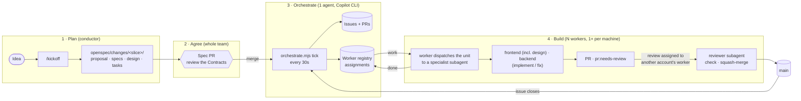
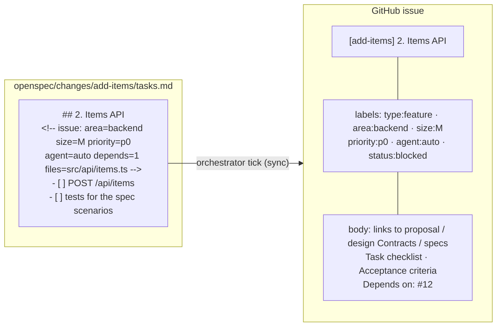
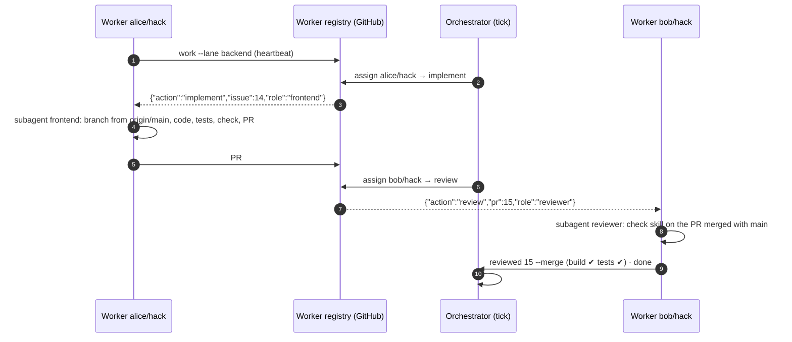
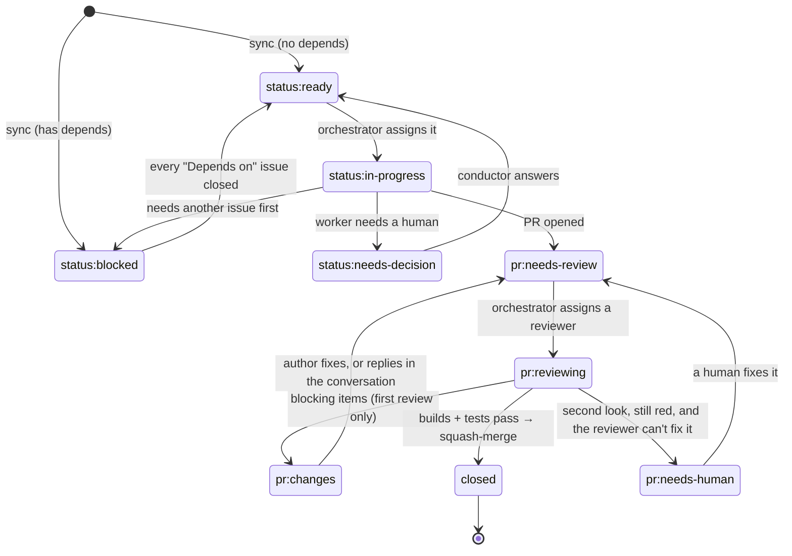

# Hackathon SDLC Kit 🚀

A GitHub template repo that turns **GitHub Copilot** (VS Code or CLI) into a fast, parallel, spec-driven SDLC for a hackathon team. One **orchestrator agent** hands out the work. **Any number of worker agents** do it, several per machine if you like. The reference setup is a 6-person team on 6 Windows machines.

You write the plan once as **[OpenSpec](https://github.com/Fission-AI/OpenSpec) changes**, and every task group becomes a GitHub issue. The orchestrator assigns issues and reviews to idle workers. The workers build, open PRs, review and merge **each other's** PRs. Humans make the decisions: they agree the contracts and answer the questions workers park for them.

No cloud agents, no GitHub Actions, no server. The shared state is GitHub itself: issues, PRs, labels, and one **Worker registry** issue. `scripts/orchestrate.mjs` reads and writes that state.

- [How it works](#how-it-works)
- [Roles](#roles)
- [Get started](#get-started): setup, playbook, changing the plan (in [docs/](docs/setup/README.md))
- [Reference](#reference)

---

## How it works



### Where the truth lives

| Thing | Location | Who writes it |
|-------|----------|---------------|
| Problem, demo script, scope, stack, lanes | `openspec/config.yaml` → `context:` | `kickoff` skill |
| Rules every agent follows when writing specs and tasks | `openspec/config.yaml` → `rules:` | the kit (don't edit during the event) |
| One vertical slice: why, requirements, **API contracts**, tasks | `openspec/changes/<id>/` | `kickoff` / `plan-feature` |
| The current, merged behavior of the system | `openspec/specs/<capability>/spec.md` | `openspec archive` |
| The backlog and its state | GitHub issue and PR labels | the orchestrator (`tick`), plus workers for their own PRs |
| Which workers exist, and what each one is doing | **Worker registry** issue: one heartbeat comment per worker, one assignments comment | each worker writes **only** its own comment, and the orchestrator writes **only** the assignments |

**Every piece of state has exactly one writer**, so nothing can race, however many workers you add.

### From a task group to an issue

Each `## N.` group in a change's `tasks.md` becomes exactly one issue and one PR. The metadata comment under the heading routes it.



An optional `assignee=<login>` in that comment reserves the group for one person, as the conductor does for `scaffold`.

### Lanes and specialists

| Lane (`area:` label) | Specialist | Does |
|---|---|---|
| `area:frontend` | `frontend` | **Design and UI in one: an avid designer as well as a frontend engineer.** It builds the design system first (tokens, components, page shell, copy, guided by the `frontend-design` skill), then screens with every state, wired to the API against the Contracts |
| `area:backend` | `backend` | API, data, LLM and external-service calls, deploy, chores. Also takes bugs and chores with no area, and archive issues |
| any PR waiting for review | `reviewer` | Runs the checks on the PR merged with `main`, applies the lane's standards, then merges or sends it back |

A worker's lane is only a **preference**. The orchestrator fills each worker's own lane first, then lets idle workers help any lane, and the worker puts on whichever specialist the unit needs. Each unit runs in a fresh subagent, so a worker can loop all day without its context filling up.

### How the orchestrator assigns work

Every 30 seconds, `tick` does the housekeeping: it creates issues for new task groups, unblocks dependents, and opens archive issues. Then it gives every **live, idle** worker the first of these that applies:

| # | Action | When | Why this order |
|---|--------|------|----------------|
| 1 | `fix` | A PR **this worker** opened was sent back (`pr:changes`) or has a merge conflict | Finishing beats starting |
| 2 | `review` | A PR is waiting (`pr:needs-review`) that was opened by **another GitHub account**, oldest first | PRs never pile up. GitHub doesn't allow approving your own PR |
| 3 | `implement` | A `status:ready` issue in the worker's lane, by priority. In a second pass, any lane | Lanes first, but nobody idles |

- **Live** means the worker polled in the last 5 minutes. A worker polls every 30 seconds while it waits.
- If a worker restarts, its unfinished assignment comes back to it.
- If a worker goes silent for **4 hours**, the orchestrator hands its work to someone else. Before that, from **2.5 hours**, it flags the worker to the conductor.
- `tick` refuses to run while **another orchestrator** was active in the last 2 minutes. There is only ever one writer of assignments.

### One unit of work, end to end



### Issue and PR lifecycle



**Review policy:** builds and unit tests pass, on the PR merged with `main`, or it doesn't merge. A PR is **sent back at most once**, with a checklist listing everything. On the second look, open points are settled in the PR conversation (the reviewer agrees, or opens a follow-up issue), and the reviewer makes a red build or failing tests green itself. A PR the reviewer can't make green goes to `pr:needs-human`. Details: the `review-pr` skill.

---

## Roles

| Role | How many | What they do |
|------|----------|--------------|
| **Conductor** (a person) | 1 | Runs `/kickoff` and drives `scaffold` interactively. Runs the orchestrator, answers the decisions it surfaces, and runs `/plan` when scope changes. Usually also runs a worker once `scaffold` merges. |
| **Orchestrator** (an agent) | exactly 1 | A Copilot CLI session on the conductor's machine (`copilot --agent orchestrator`). It assigns every unit of work, keeps the board moving, and flags what needs a human. It never writes code. |
| **Workers** (agents) | any number | Each one is a long-running Copilot session in its own folder, with a preferred lane (`frontend` or `backend`). A worker doesn't write code itself: it hands each unit to a **specialist**. The demo has 6 machines: start with one worker per machine, and add more per machine with `worktree` if the machine and the backlog can take it. |
| **Specialists** (agents) | one per unit | `frontend` (which is also the designer), `backend` and `reviewer`. The worker starts one as a **subagent** with a fresh context for each unit, picked by the unit's `role` (from the issue's `area:` label, or `reviewer` for reviews). Their know-how lives in the `role-frontend` (with `frontend-design`) and `role-backend` skills. |
| **Teammates** (people) | everyone | Watch their machine's workers, approve anything a worker asks permission for, step in when one goes off track, and restart a worker when its chat gets long. |

`agent:auto` marks issues that are specified well enough to finish with **no human decisions**. A worker started with `/work <lane> auto-only` takes only those, which is useful when nobody is watching it.

---

## Get started

Everything about **setting up and running** the kit lives in `docs/`, not in this README:

| You want to… | Read |
|---|---|
| Add the kit to your own project, with no cloning of this repo: `npx -y github:KKogaa/hackathon-sdlc-kit` | [docs/setup/repo.md](docs/setup/repo.md) |
| Set up your machine, by profile (every machine, repo owner, conductor, worker), and see the 6-machine layout | **[docs/setup/](docs/setup/README.md)** |
| Know what to do during the day: kickoff, build loop, final 2 hours | [docs/playbook.md](docs/playbook.md) |
| Add a feature, file a bug, reprioritize or cancel mid-hackathon | [docs/changing-the-plan.md](docs/changing-the-plan.md) |

---

## Reference

### The skills

Copilot reads skill descriptions and loads the right one automatically, and the worker agent calls them by name. They work in VS Code agent mode, Copilot CLI, Claude Code, and any other `AGENTS.md`-aware agent.

| Skill | Phase | Used by |
|-------|-------|---------|
| `kickoff` | Plan | `/kickoff` |
| `plan-feature` | Plan | `/plan` |
| `implement-issue` | Build | specialists: `implement` |
| `role-frontend` (design included), `role-backend` | Build | the matching specialist, and `reviewer` for lane standards |
| `fix-pr` | Build | specialists: `fix` |
| `check` | Test (the CI) | `implement-issue`, `open-pr`, `review-pr` |
| `write-tests` | Test | `implement-issue` |
| `open-pr` | Ship | `implement-issue` |
| `review-pr` | Review | `reviewer` |
| `standup` | Track | `/standup` |
| `ship-release` | Release | "Cut the demo release" |
| `demo-prep` | Demo | `/demo` |
| `frontend-design` | Design | `role-frontend`. Anthropic's skill, **not shipped**: each teammate installs it in [setup](docs/setup/windows-base.md#4-install-the-design-skill) |
| `openspec-*` | Spec | the skills above, and `/opsx-*` |

### Prompts (VS Code slash commands)

| Prompt (VS Code) | Who | What it does |
|------------------|-----|--------------|
| `/work <lane>` | everyone | The worker loop |
| `/orchestrate` | conductor (once) | The orchestrator loop, if not using Copilot CLI |
| `/kickoff <idea>` | conductor | Idea → OpenSpec brief and changes → spec PR |
| `/plan <feature>` | conductor | New feature → OpenSpec change → spec PR, in VS Code. Or just ask the orchestrator |
| `/decide` | conductor | Walk through the questions workers parked |
| `/standup` | anyone | Team status to paste in the chat |
| `/demo` | conductor | Submission and demo prep |
| `/opsx-*` | anyone | OpenSpec's own commands (propose, apply, archive, explore…) |

Prompt files are a VS Code feature. In Copilot CLI, pick the agent with `/agent conductor` (or `copilot --agent conductor`) and ask in plain words, for example *"use the kickoff skill: we're building …"*.

### Labels

| Group | Labels | Set by |
|-------|--------|--------|
| status | `status:ready` `status:in-progress` `status:blocked` `status:needs-decision` | orchestrator, workers, `/decide` |
| pr | `pr:needs-review` `pr:reviewing` `pr:changes` (sent back, once) `pr:needs-human` (the reviewer couldn't make it green) | `open-pr`, orchestrator, `review-pr` |
| area (lane) | `area:frontend` (design included) `area:backend` | `tasks.md` metadata |
| size | `size:S` (<1h) `size:M` (1–2h) `size:L` (split it) | `tasks.md` metadata |
| priority | `priority:p0` (demo path) `priority:p1` `priority:p2` | `tasks.md` metadata |
| type | `type:feature` `type:bug` `type:chore` `type:docs` `type:feature-request` | `tasks.md` metadata, issue templates (feature requests wait for the conductor) |
| agent | `agent:auto`: an unattended worker can finish it | `tasks.md` metadata |

### The orchestrator

```
# anyone
node scripts/orchestrate.mjs status                        # board, workers and assignments (read-only)
node scripts/orchestrate.mjs sync --dry-run                # preview the issues a spec would create

# orchestrator (exactly one)
node scripts/orchestrate.mjs setup                         # labels + worker registry issue (once, safe to repeat)
node scripts/orchestrate.mjs tick --watch 10               # assign work every 30s for 10 min, then report
node scripts/orchestrate.mjs take scaffold                 # assign a change's open issues to me

# worker (any number)
node scripts/orchestrate.mjs work --lane frontend --wait 10 # heartbeat + my unit and its role as JSON (waits up to 10 min)
node scripts/orchestrate.mjs done                          # I finished my unit
node scripts/orchestrate.mjs reviewed 15 --merge --body-file r.md  # approve + merge (or --changes: once per PR)
node scripts/orchestrate.mjs worktree w2                   # a folder for another worker on this machine
```

### Checks (the CI)

The `check` skill runs `openspec validate --all --strict`, then the Install, Lint, Test and Build commands from the **Commands** table in `AGENTS.md`. `scaffold` fills those in. The author runs it before opening a PR, and the reviewer runs it again on the PR merged with `main` before merging. Both run the same commands because both read them from the same table.

### What's in the repo

| Path | Purpose |
|------|---------|
| `docs/setup/` | Setup, one page per machine profile: every machine, repo owner, conductor, worker |
| `docs/playbook.md`, `docs/changing-the-plan.md` | Running the day, and changing scope mid-event |
| `openspec/config.yaml` | Project brief, plus the rules that make agents write issue-ready tasks |
| `openspec/changes/`, `openspec/specs/` | Planned changes, and the merged spec of the system |
| `.github/agents/` | Custom agents (VS Code and Copilot CLI): `orchestrator` (exactly one), `worker` (any number), the specialists `frontend` (design included), `backend` and `reviewer`, and `conductor` |
| `.github/prompts/` | `/work`, `/orchestrate`, `/kickoff`, `/plan`, `/decide`, `/standup`, `/demo`, `/opsx-*` |
| `.github/skills/*/SKILL.md` | Agent Skills: the SDLC workflows |
| `.github/copilot-instructions.md`, `AGENTS.md` | Always-on rules and the team workflow |
| `.vscode/settings.json` | Agent skills on, high request limit, terminal auto-approve for routine commands |
| `scripts/orchestrate.mjs` | The coordinator (Node, no dependencies): labels, worker registry, sync, assignment, unblock, archive, worktrees. The only script in the kit |
| `.github/ISSUE_TEMPLATE/`, `.github/pull_request_template.md` | Bug/task templates and the PR checklist |
| `bin/create.mjs`, `package.json` | The `npx` installer. Not copied by it. If you used the template, `scaffold` can delete them or replace `package.json` with the project's own |

### Compatibility

At the hackathon **every teammate is on Windows**. That is the only platform the kit has to work on. Linux is only where the kit itself is developed.

| Windows, any shell (PowerShell, CMD, Git Bash) | |
|---|---|
| **VS Code Copilot Chat** (`/work`, prompts, custom agents, skills): the default | ✅ |
| **Copilot CLI** (`--agent orchestrator`, `--agent worker`): preferred for the orchestrator | ✅ needs PowerShell 7 |

Rules for changing the kit:
- **No bash scripts.** Automation is a skill, which the agent runs, or Node with no dependencies, like `scripts/orchestrate.mjs`. In Node, never spawn POSIX-only binaries such as `sleep` or `which`, and build paths with `node:path`.
- **Commands in skills and agents must run in PowerShell 5.1, PowerShell 7, CMD and Git Bash.** That means one plain command per line: no `&&` or `;` chains, no `\` line continuations, no pipes, redirects or `$(...)`. Always quote `"@me"` (and `"repos/{owner}/{repo}"`). Write files with the agent's file tool, not with shell redirects.
- An agent feature must work in **both** VS Code and Copilot CLI. If something exists in only one, such as prompt files, which the CLI doesn't have, document the fallback for the other.
- Files stay **LF** (`.gitattributes`, `files.eol`).
- Passing on Linux proves nothing about Windows. If a change wasn't tried on Windows, say so in the PR.

## Rules that keep it fast

1. **Contracts first.** Frontend and backend build against the `## Contracts` in each change's `design.md`, not against each other.
2. **One task group = one issue = one PR**, under 400 lines, squash-merged.
3. **Only the orchestrator assigns work.** Single-writer assignment is what lets you add workers without collisions.
4. **Finish before starting**: fix your PRs, then review, then build.
5. **Never break main.** The checks failing on main is p0 for everyone.
