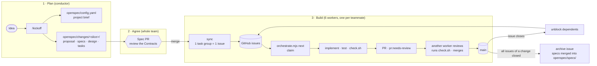
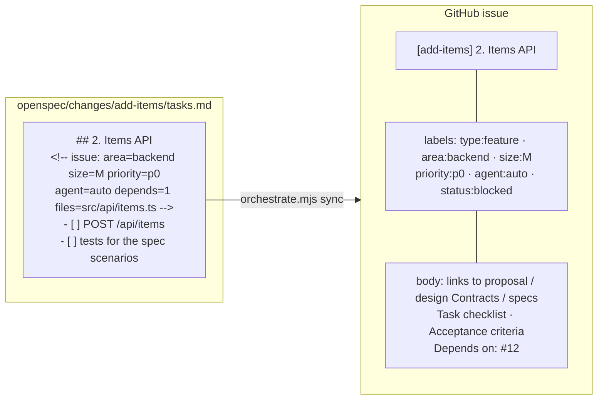
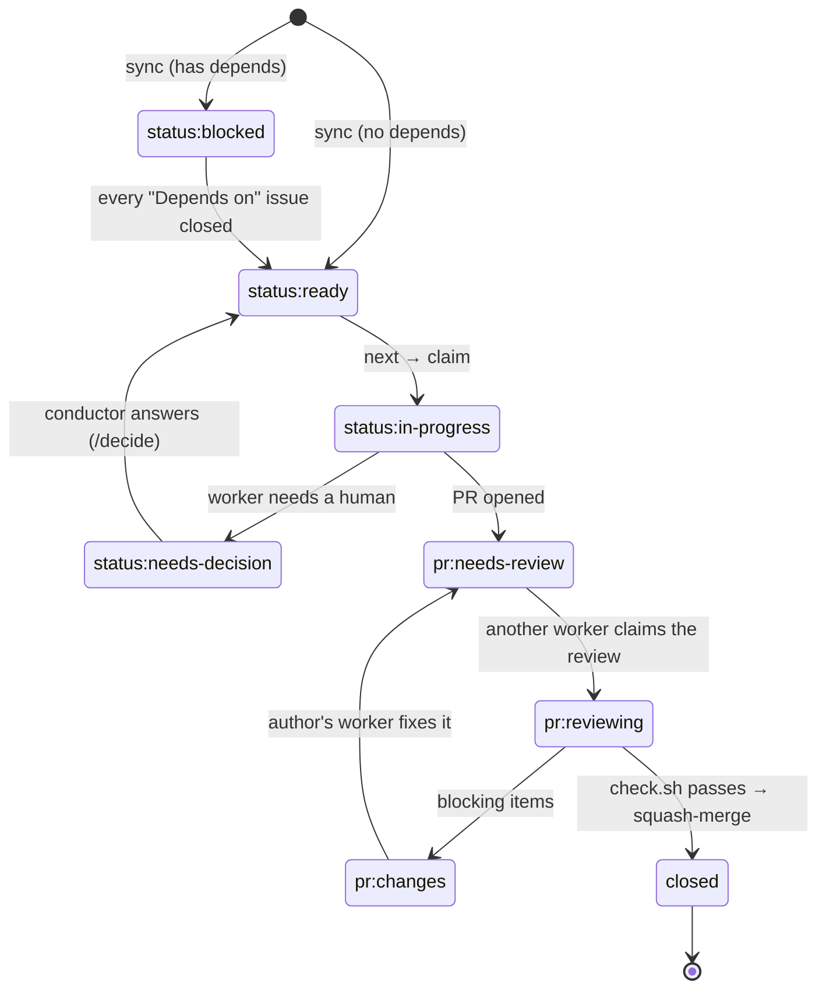
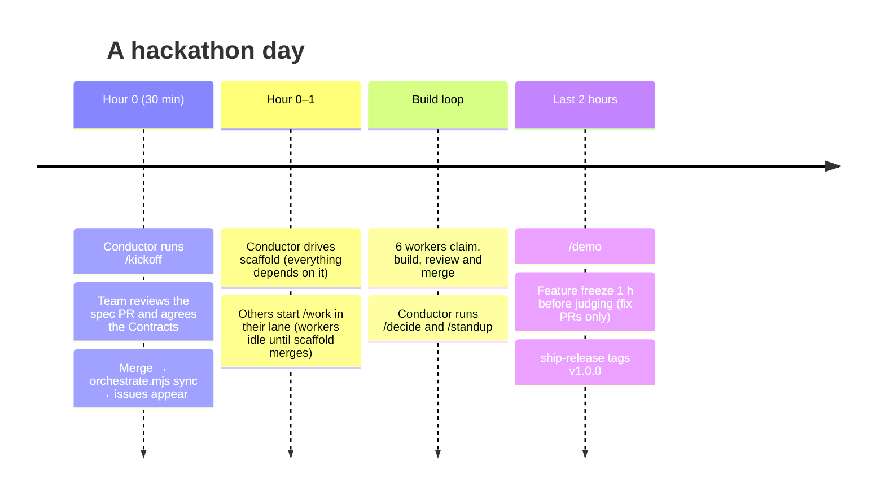
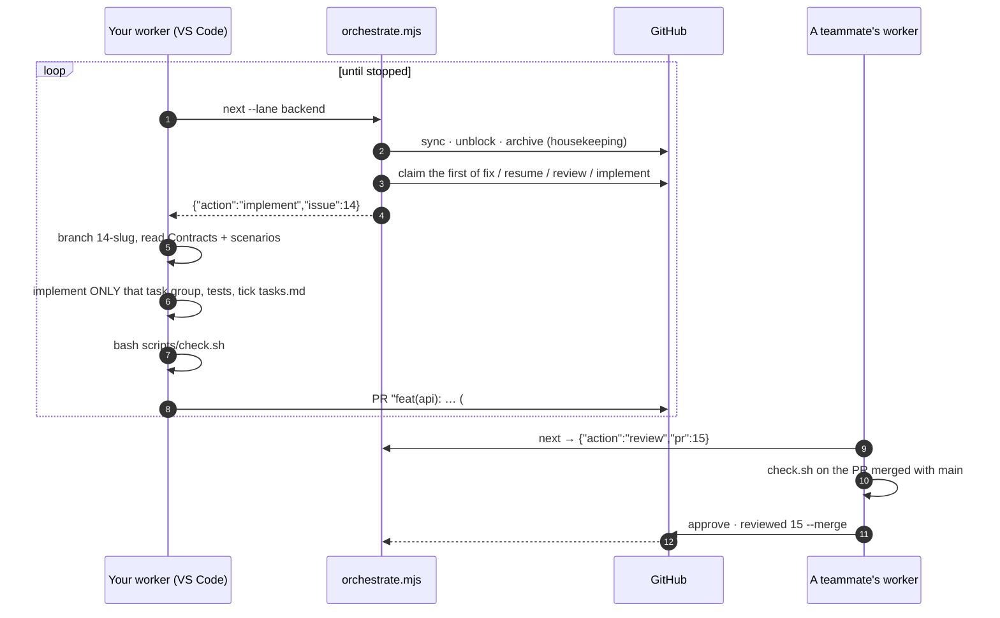
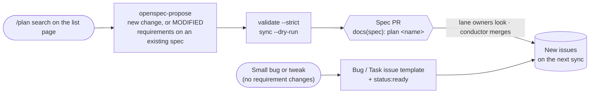

# Hackathon SDLC Kit 🚀

A GitHub template repo that turns **GitHub Copilot** (VS Code or CLI) into a fast, parallel, spec-driven SDLC for a 6-person hackathon team.

You write the plan once as **[OpenSpec](https://github.com/Fission-AI/OpenSpec) changes**. Every task group becomes a GitHub issue. Then each of the 6 teammates starts **one worker agent** on their own machine and leaves it running. The workers claim issues, build them, open PRs, review and merge **each other's** PRs, and unblock what comes next. Humans make the decisions: they agree the contracts and answer the questions workers park for them.

No cloud agents, no GitHub Actions, no server. GitHub issues, PRs and labels are the shared state, and `scripts/orchestrate.mjs` is the coordinator every worker calls.

- [How it works](#how-it-works)
- [Roles](#roles)
- [Setup](#setup-once-about-10-minutes)
- [Hackathon playbook](#hackathon-playbook)
- [Running a worker](#running-a-worker)
- [Planning a new feature mid-hackathon](#planning-a-new-feature-mid-hackathon)
- [Reference](#reference)

---

## How it works



### Where the truth lives

| Thing | Location | Who writes it |
|-------|----------|---------------|
| Problem, demo script, scope, stack, lanes | `openspec/config.yaml` → `context:` | `kickoff` skill |
| Rules every agent follows when writing specs and tasks | `openspec/config.yaml` → `rules:` | the kit (don't edit during the event) |
| One vertical slice: why, requirements, **API contracts**, tasks | `openspec/changes/<id>/` | `kickoff` / `plan-feature` |
| The current, merged behavior of the system | `openspec/specs/<capability>/spec.md` | `openspec archive` |
| Who is doing what right now | GitHub issue and PR labels and assignees | `orchestrate.mjs` |

### From a task group to an issue

Each `## N.` group in a change's `tasks.md` becomes exactly one issue and one PR. The metadata comment under the heading routes it.



### What a worker does next

Every time a worker finishes a unit, it asks `node scripts/orchestrate.mjs next`. The orchestrator first does the housekeeping (sync new task groups into issues, unblock dependents, open archive issues), then hands back the first of these that applies, **already claimed**:

| # | Action | When | Why this order |
|---|--------|------|----------------|
| 1 | `fix` | One of *my* PRs was sent back (`pr:changes`) or has a merge conflict | Finishing beats starting |
| 2 | `resume` | An issue I claimed has no PR yet (my last session died) | Nothing stays orphaned |
| 3 | `review` | A teammate's PR is waiting (`pr:needs-review`), oldest first | PRs never pile up |
| 4 | `implement` | A `status:ready` issue, my lane first, then any lane, by priority | Nobody idles |
| — | `idle` | Nothing yet: it waits and re-checks every minute | |

**Claiming is race-safe.** A worker assigns itself, then reads the issue's event history. If another worker was assigned first, it backs off and tries the next one. Duplicate issues from two workers syncing at once are closed automatically. Every step is idempotent.

### Issue and PR lifecycle



---

## Roles

| Role | Who | What they do |
|------|-----|--------------|
| **Conductor** | 1 person | Runs `/kickoff`, drives `scaffold` interactively, answers parked questions with `/decide`, runs `/plan` when scope changes and `/standup` every ~2 hours. Starts their own worker once `scaffold` merges. |
| **Lane workers** | everyone | One worker each, on a lane: `frontend`, `backend`, `ai` or `infra` (two lanes get two people). A worker takes its own lane first and helps other lanes when its own is empty. |

**The human's job** while their worker runs: watch it, approve anything it asks permission for, step in when it goes off track, and keep an eye on the `status:needs-decision` questions in their lane.

`agent:auto` marks issues that are specified well enough to finish with **no human decisions**. Workers started with `--auto-only` (for example a CLI worker left running overnight) take only those.

---

## Setup (once, about 10 minutes)

1. **Create the repo from the template**: click *Use this template* → *Create a new repository*, or run:
   ```bash
   gh repo create <org>/<project> --template KKogaa/hackathon-sdlc-kit --private --clone
   ```
2. Add your teammates as collaborators.
3. Create the labels: `bash scripts/setup-labels.sh`
4. **Protect `main`**: require a pull request with 1 approval, and turn on squash merge plus auto-delete of head branches. Workers approve each other's PRs under their own accounts, so it never needs a human click. Don't require status checks: there is no CI, because `scripts/check.sh` runs locally.
5. **Every teammate**:
   - installs `gh` and runs `gh auth login`. A worker claims work as you.
   - installs OpenSpec: `npm install -g @fission-ai/openspec@1.14.3`
   - opens the repo in VS Code with Copilot Chat. The workspace settings in `.vscode/settings.json` turn on agent skills, raise the agent's request limit, and auto-approve the team's routine terminal commands (`git`, `gh`, `openspec`, tests, the scripts), so the worker doesn't stop for a click on each one. Anything else still asks.
   - optional: installs [Copilot CLI](https://github.com/github/copilot-cli) to run the [autopilot worker](#copilot-cli-autopilot-optional)

---

## Hackathon playbook



### Hour 0: Kickoff (whole team, about 30 minutes)

1. The conductor runs, in VS Code Copilot Chat:
   > `/kickoff an AI study buddy for Spanish learners`

   The agent asks for anything it's missing in one message, then:
   - fills the project brief in `openspec/config.yaml`
   - creates a `scaffold` change plus 4–8 vertical-slice changes, each with a **Contracts** section in `design.md`
   - runs `openspec validate --all --strict` and previews the backlog with `node scripts/orchestrate.mjs sync --dry-run`
   - opens the spec PR `docs(spec): MVP spec and contracts`
2. **The whole team reviews the spec PR together**, mostly the `## Contracts` sections. This is the most important review of the day, because six workers will build against these shapes in parallel.
3. Merge it, then run `node scripts/orchestrate.mjs sync`. The issues appear with their dependencies linked.
4. The conductor drives `scaffold`: repo skeleton, lint/test/build wired into `scripts/check.sh`, the **Commands** table in `AGENTS.md`, hello world deployed. Everyone else starts their worker. Workers sit `idle` until `scaffold` merges, then the whole board unblocks at once.

### During the build

- **Every ~45 minutes, glance at your worker.** If its chat has grown long, start a new chat and run `/work <lane>` again. A fresh context keeps it fast and focused, and it resumes anything it had claimed.
- **Conductor:** `/decide` whenever `status:needs-decision` issues appear (each one is an idle worker's question), and `/standup` every couple of hours. Post the standup in the team chat.
- **Lanes running dry?** The standup flags it. Workers already spill over into other lanes, but you can also restart one on a busier lane.

### Final 2 hours

- `/demo` produces the README, `docs/DEMO.md`, a seed script, and a list of demo-path risks.
- Feature freeze 1 hour before judging: only `fix:` PRs on the demo path get merged. Stop the workers once the board is empty.
- *"Cut the demo release"* (the `ship-release` skill) tags v1.0.0, deploys, and smoke-tests.

---

## Running a worker

### VS Code (default)

Open Copilot Chat and run:

> `/work backend`

That starts the `worker` custom agent in a loop: `next` → do the unit → report one line → `next` … It keeps going until you stop it or the chat gets too long. In that case it tells you to open a new chat and run `/work` again.



### Copilot CLI autopilot (optional)

```bash
bash scripts/worker.sh backend              # every issue
bash scripts/worker.sh backend --auto-only  # only agent:auto issues, e.g. when nobody is watching
```

Each unit of work gets a **fresh** `copilot -p` session with the `worker` agent, so the context never fills up and it can run all day in a terminal. It runs with `--allow-all-tools` (minus force-push, `rm -rf` and repo deletion), so run it only in your clone of this repo. Logs go to `.worker-logs/`. Stop it with Ctrl-C.

**Run one worker per teammate.** Claims are made under your `gh` login, so two workers on the same account would look like one person to the orchestrator.

### Prompts

| Prompt (VS Code) | Who | What it does |
|------------------|-----|--------------|
| `/work <lane>` | everyone | The worker loop |
| `/kickoff <idea>` | conductor | Idea → OpenSpec brief and changes → spec PR |
| `/plan <feature>` | conductor | New feature → OpenSpec change → spec PR |
| `/decide` | conductor | Walk through the questions workers parked |
| `/standup` | anyone | Team status to paste in the chat |
| `/demo` | conductor | Submission and demo prep |
| `/opsx-*` | anyone | OpenSpec's own commands (propose, apply, archive, explore…) |

Copilot CLI has no prompt files. Ask in plain words instead (*"use the kickoff skill…"*), or use `--agent worker` / `--agent conductor`.

---

## Planning a new feature mid-hackathon

Every feature goes through OpenSpec. **Don't create feature issues by hand**: workers create them from `tasks.md`.



When every issue of a change is closed, the orchestrator opens an `[<change>] archive the change` issue (`agent:auto`). The worker that takes it runs `openspec archive <id> --yes`, which merges the change's spec deltas into `openspec/specs/`, so the next change builds on an up-to-date spec.

---

## Reference

### The skills

Copilot reads skill descriptions and loads the right one automatically, and the worker agent calls them by name. They work in VS Code agent mode, Copilot CLI, Claude Code, and any other `AGENTS.md`-aware agent.

| Skill | Phase | Used by |
|-------|-------|---------|
| `kickoff` | Plan | `/kickoff` |
| `plan-feature` | Plan | `/plan` |
| `implement-issue` | Build | worker: `implement`, `resume` |
| `write-tests` | Test | `implement-issue` |
| `open-pr` | Ship | `implement-issue` |
| `review-pr` | Review | worker: `review` |
| `standup` | Track | `/standup` |
| `ship-release` | Release | "Cut the demo release" |
| `demo-prep` | Demo | `/demo` |
| `openspec-*` | Spec | the skills above, and `/opsx-*` |

### Labels

| Group | Labels | Set by |
|-------|--------|--------|
| status | `status:ready` `status:in-progress` `status:blocked` `status:needs-decision` | orchestrator, workers, `/decide` |
| pr | `pr:needs-review` `pr:reviewing` `pr:changes` | `open-pr`, orchestrator, `review-pr` |
| area (lane) | `area:frontend` `area:backend` `area:ai` `area:infra` | `tasks.md` metadata |
| size | `size:S` (<1h) `size:M` (1–2h) `size:L` (split it) | `tasks.md` metadata |
| priority | `priority:p0` (demo path) `priority:p1` `priority:p2` | `tasks.md` metadata |
| type | `type:feature` `type:bug` `type:chore` `type:docs` | `tasks.md` metadata, issue templates |
| agent | `agent:auto`: an unattended worker can finish it | `tasks.md` metadata |

### The orchestrator

```bash
node scripts/orchestrate.mjs status                        # the board (read-only)
node scripts/orchestrate.mjs next --lane frontend          # claim my next unit (JSON on stdout)
node scripts/orchestrate.mjs next --lane ai --wait 10      # …waiting up to 10 min for work
node scripts/orchestrate.mjs reviewed 15 --merge           # after a review: merge (or --changes)
node scripts/orchestrate.mjs sync --dry-run                # preview the issues a spec would create
node scripts/orchestrate.mjs housekeeping                  # sync + unblock + archive
```

### Checks (the CI)

`bash scripts/check.sh` detects the stack and runs what applies: `openspec validate --all --strict`, then Node and/or Python lint, test and build. The author runs it before opening a PR, and the reviewer runs it again on the PR merged with `main` before merging.

### What's in the repo

| Path | Purpose |
|------|---------|
| `openspec/config.yaml` | Project brief, plus the rules that make agents write issue-ready tasks |
| `openspec/changes/`, `openspec/specs/` | Planned changes, and the merged spec of the system |
| `.github/agents/` | `worker` and `conductor` custom agents (VS Code and Copilot CLI) |
| `.github/prompts/` | `/work`, `/kickoff`, `/plan`, `/decide`, `/standup`, `/demo`, `/opsx-*` |
| `.github/skills/*/SKILL.md` | Agent Skills: the SDLC workflows |
| `.github/copilot-instructions.md`, `AGENTS.md` | Always-on rules and the team workflow |
| `.vscode/settings.json` | Agent skills on, high request limit, terminal auto-approve for routine commands |
| `scripts/orchestrate.mjs` | The coordinator: sync, claim, unblock, review bookkeeping, archive |
| `scripts/check.sh` | Local CI |
| `scripts/worker.sh` | Copilot CLI autopilot worker |
| `scripts/setup-labels.sh` | Creates the labels |
| `.github/ISSUE_TEMPLATE/`, `.github/pull_request_template.md` | Bug/task templates and the PR checklist |

## Rules that keep it fast

1. **Contracts first.** Frontend and backend build against the `## Contracts` in each change's `design.md`, not against each other.
2. **One task group = one issue = one PR**, under 400 lines, squash-merged.
3. **Let the orchestrator claim.** It's what stops 6 workers from colliding.
4. **Finish before starting**: fix your PRs, then review, then build.
5. **Never break main.** `check.sh` failing on main is p0 for everyone.
