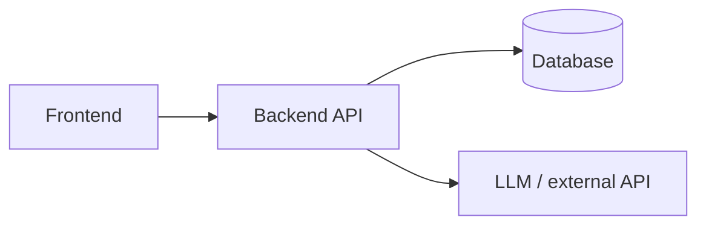

# Spec: <Project name>

> Filled in by the `kickoff` skill. Keep it to one page. This is the team's source of truth.

## Problem
<!-- Who has what problem, in one or two sentences -->

## Demo script
1.
2.
3.

## MVP scope
**In:**
-

**Out (explicitly):**
-

## Architecture


## Tech stack
| Layer | Choice | Why |
|-------|--------|-----|
|       |        |     |

## API contracts
<!-- Define these FIRST so the frontend and backend can be built in parallel against them -->
```
POST /api/...
  req:  { }
  res:  201 { }
```

## Data model
```
```

## Env vars
| Name | Used by | Notes |
|------|---------|-------|
